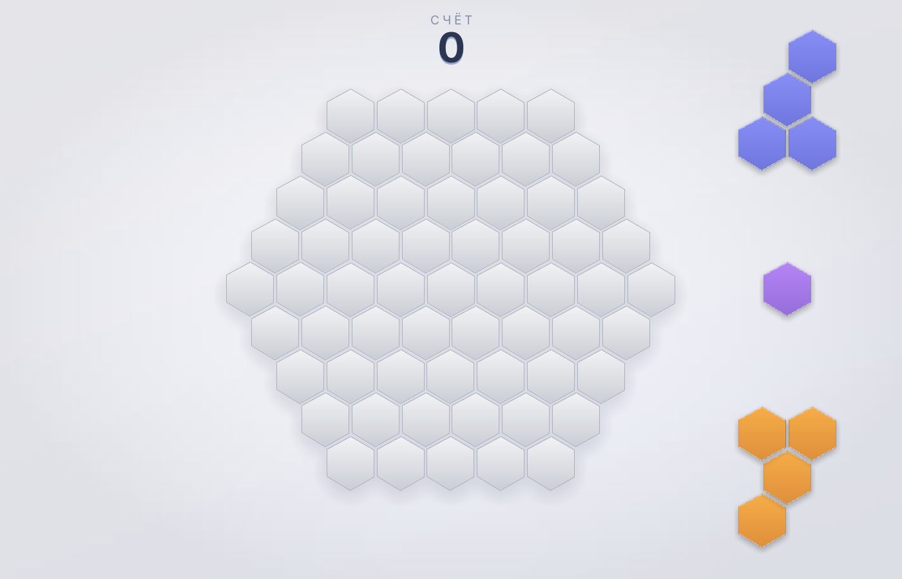
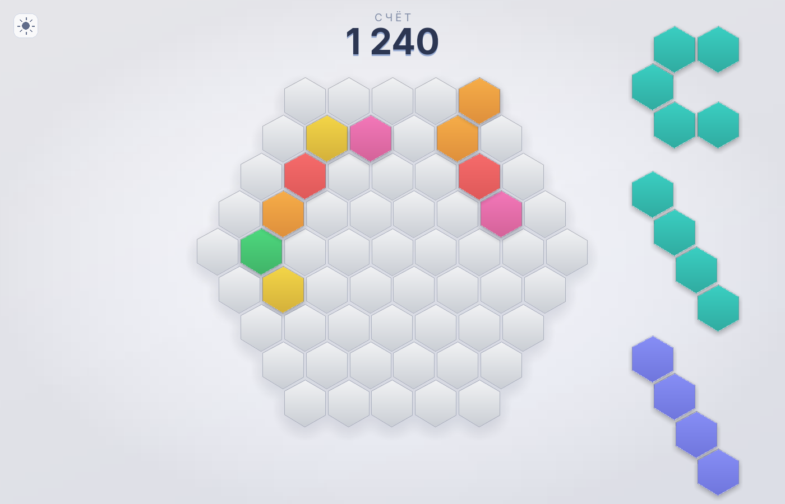
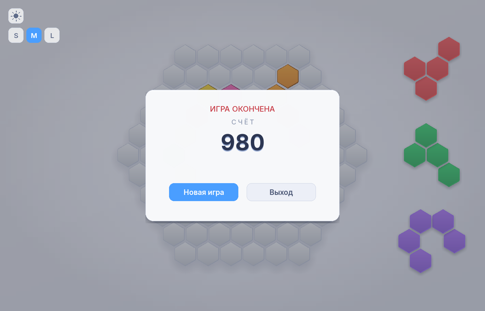

# Hexagon
Игра Hexagon

Hexagon - игра, на которую я случайно наткнулся в интернете и решил повторить на Python (с использованием библиотеки pygame-ce). Правила игры немного напоминают правила Тетрис.
На игровом поле также нужно выстраивать полные линии, выкладывая фигурки, чтобы удалить их, с той лишь разницей, что поле в Hexagon состоит не из квадратиков, а из шестиугольных ячеек - гексов - и фигурки не падают сверху, а выбираются из случайным образом пополняемого "пула"

## Установка и запуск

Игра использует [pygame-ce](https://pyga.me/) - активно развиваемый форк pygame с тем же API.

```bash
pip install -r requirements.txt
python3 start.pyw
```

Если раньше был установлен обычный `pygame`, его нужно удалить: оба пакета ставятся
в один и тот же каталог `pygame/`, и вместе они работают непредсказуемо.

```bash
pip uninstall -y pygame
pip install -r requirements.txt
python3 -c "import pygame; print(pygame.version.ver, pygame.IS_CE)"  # должно быть 2.5.x 1
```

Для запуска двойным кликом в Linux файлу нужны права на выполнение:

```bash
chmod +x start.pyw
```

При запуске двойным кликом сообщения об ошибках некуда выводить, поэтому
`start.pyw` перед созданием окна проверяет окружение. Если установлен не тот
pygame или его нет вовсе, вместо чёрного окна появится диалог с текстом
проблемы и командой для исправления; тот же текст сохраняется в `error.log`
рядом с игрой.

Код игры разбит на несколько файлов:
1) start.pyw (точка входа: проверяет окружение, показывает ошибки и запускает игру)
2) main.py (основной игровой цикл)
3) classes.py (в нем находятся классы, реализующие основную логику игры)
4) utils.py (в нем находится несколько вспомогательных функций, например, для создания списка координат отдельных гексов и сглаживания их углов)
5) settings.py (файл с настройками игры, такими например, как размер окна, размер гексов, цвет пустых гексов и т.д.)
6) theme.py (цвета светлой и тёмной темы)
7) sprites.py (кэш готовых спрайтов: тени, градиенты, сглаженные контуры)
8) fonts.py (загрузка шрифта Inter)

Кратко о назначении отдельных классов:
- Layer - базовый слой отрисовки. Каждый слой хранит собственную поверхность и знает, какая её часть изменилась с прошлого кадра, поэтому перерисовывается только она.
- Renderer - собирает кадр из слоёв: накладывает фон и слои только в изменившихся областях и обновляет экран.
- Background - генерирует фоновый рисунок (градиент, виньетку и шум) и отрисовывает его.
- Hexagon, FieldHexagon, FigureHexagon - классы для представления гексов, входящих в фигуры, и гексов на игровом поле. Класс Hexagon является суперклассом для двух других,           инкапсулирующим общие свойства и поведение.
- Figure - служит для представления фигур из гексов. Хранит список входящих в фигуру гексов, позволяя обращаться к ним, как к отдельному целому объекту. Содержит много методов для   делегирования поведения. Например, мы можем передвинуть фигуру на указанное смещение не передавая его напрямую каждому отдельному входящему в фигуру гексу, а передав требуемое     смещение фигуре, соответствующий метод которой уже передаст его входящим в фигуру гексам.
- Pool - генерирует весь комплект фигур и случайным образом отбирает фигуры из созданного комплекта для отдельных ходов. Рисуется как карточка со скруглёнными углами.
- Field - представляет игровое поле. Также содержит методы для удаления полных линий и определения наличия доступных ходов (если доступных ходов не осталось - игра прекращается).
- DragAndDrop - реализует возможность перетаскивания фигур из пула на игровое поле с помощью мышки.
- FxLayer - слой эффектов: искры при удалении линий и всплывающие очки.
- Tab - панель для отображения количества очков.

## Как устроена отрисовка

Каждый слой (поле, пул, фигура под курсором, эффекты, счёт) рисует себя в
собственную поверхность размером с окно и помнит прямоугольник, который изменился
с прошлого кадра. При сборке кадра фон и слои накладываются только внутри этих
прямоугольников, а в `display.update()` передаётся тот же список.

Гексы не рисуются полигонами каждый кадр: `sprites.py` заранее собирает их в
картинки (мягкая тень через `box_blur`, вертикальный градиент, светлая кромка,
сглаженный контур) и кэширует по теме, цвету, состоянию и шагу масштаба. Блит
готового спрайта дешевле, чем `polygon` с антиалиасингом, поэтому эффекты не
замедляют, а ускоряют кадр.

Практический результат: полностью статичный кадр не стоит почти ничего, а во
время перетаскивания фигуры перерисовывается лишь область вокруг неё, а не весь
экран. Новый слой достаточно унаследовать от `Layer` и реализовать `redraw()` и
`update()`.

## Темы

Клавиша **T** (или **F1**) переключает светлую и тёмную тему. Цвета обеих тем
лежат в `theme.py`, а фигура хранит не RGB, а индекс в палитре, поэтому смена
темы не требует перекрашивать объекты игры.

## Шрифт

В `assets/fonts` лежит [Inter](https://rsms.me/inter/) под лицензией
SIL Open Font License 1.1 (текст лицензии рядом, в `assets/fonts/LICENSE.txt`).
Если файлы шрифта недоступны, игра возьмёт системный шрифт.






