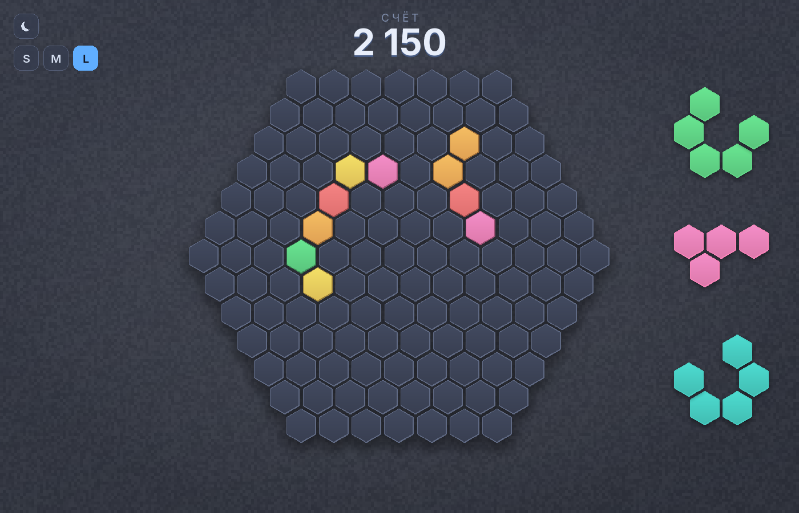
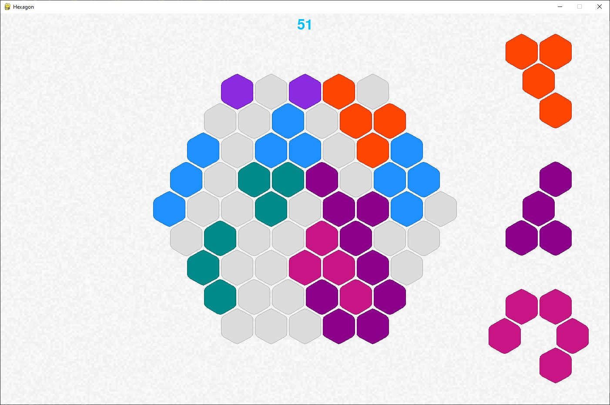

# Hexagon
Игра Hexagon

Hexagon - игра, на которую я случайно наткнулся в интернете и решил повторить на Python (с использованием библиотеки pygame-ce). Правила игры немного напоминают правила Тетрис.
На игровом поле также нужно выстраивать полные линии, выкладывая фигурки, чтобы удалить их, с той лишь разницей, что поле в Hexagon состоит не из квадратиков, а из шестиугольных ячеек - гексов - и фигурки не падают сверху, а выбираются из случайным образом пополняемого "пула"

Код игры разбит на несколько файлов:
1) start.pyw (точка входа: проверяет окружение, показывает ошибки при запуске без терминала и запускает игру)
2) main.py (основной игровой цикл)
3) classes.py (в нем находятся классы, реализующие основную логику игры)
4) utils.py (в нем находится несколько вспомогательных функций, например, построение контура гекса со скруглёнными углами)
5) settings.py (файл с настройками игры, такими например, как размер окна и отступы гексов)
6) config.py (размеры игрового поля и сохранение выбранных настроек)
7) theme.py (цвета светлой и тёмной темы)
8) sprites.py (кэш готовых спрайтов гексов: тени, градиенты, сглаженные контуры)
9) fonts.py (загрузка шрифта интерфейса)
10) records.py (таблица лучших результатов по каждому размеру поля)

Кратко о назначении отдельных классов:
- Layer - базовый слой отрисовки. Хранит свою поверхность и помнит, какая её часть изменилась с прошлого кадра, поэтому перерисовывается только она.
- Renderer - собирает кадр из слоёв и обновляет на экране только изменившиеся области.
- Background - генерирует фоновый рисунок (градиент, виньетку и шум) и отрисовывает его.
- Hexagon, FieldHexagon, FigureHexagon - классы для представления гексов, входящих в фигуры, и гексов на игровом поле. Класс Hexagon является суперклассом для двух других,           инкапсулирующим общие свойства и поведение.
- Figure - служит для представления фигур из гексов. Хранит список входящих в фигуру гексов, позволяя обращаться к ним, как к отдельному целому объекту. Содержит много методов для   делегирования поведения. Например, мы можем передвинуть фигуру на указанное смещение не передавая его напрямую каждому отдельному входящему в фигуру гексу, а передав требуемое     смещение фигуре, соответствующий метод которой уже передаст его входящим в фигуру гексам.
- Pool - генерирует весь комплект фигур и случайным образом отбирает фигуры из созданного комплекта для отдельных ходов.
- Field - представляет игровое поле. Также содержит методы для удаления полных линий и определения наличия доступных ходов (если доступных ходов не осталось - игра прекращается).
- DragAndDrop - реализует возможность перетаскивания фигур из пула на игровое поле с помощью мышки.
- FxLayer - слой эффектов: искры при удалении линий и всплывающие очки.
- Tab - панель для отображения количества очков и итоговый экран с кнопками.
- Leaderboard - таблица лучших результатов в левом нижнем углу: тройка на каждый размер поля.
- ThemeButton - кнопка переключения светлой и тёмной темы.
- SizeButton - три кнопки выбора размера поля.
- VolumeButton - переключатель объёмных и плоских гексов.




## Доработки с помощью ИИ

Исходная версия игры была написана и лежала в репозитории. Ниже — что было
доработано позже: графика, темы, скорость, а также ошибки, которые удалось найти
и исправить по ходу.

### Как было и как стало

| До | После |
|---|---|
|  |  |

Слева — исходное оформление: плоские гексы с контуром, ровный шум на фоне,
одна цифра счёта в верхнем углу. Справа — текущий вид.

### Графика и анимации

Гексы перестали быть плоскими полигонами. Каждый рисуется в отдельную картинку:
мягкая тень, вертикальный градиент, сглаженный контур. Тень под всей доской
создаёт ощущение, что поле лежит над фоном, а не нарисовано на нём.

Углы гексов скруглены: каждый угол заменён небольшой дугой радиусом 3 px
(`utils.hexagon_points`). Контур строится один раз и используется и для
отрисовки, и для проверки попадания мышью, поэтому картинка и логика не
расходятся. Радиус скругления задаётся параметром `CORNER_ROUNDING`
в `settings.py` и масштабируется вместе с гексом, так что при уменьшении
фигуры форма не меняется.

У каждого гекса есть обводка толщиной `BORDER_WIDTH` (2 px), растущая внутрь
контура. Встроенный `gfxdraw.aapolygon` рисует линию всего в один пиксель,
и после скругления углов такая обводка почти пропадала.

Цвет обводки зависит от того, где гекс: у фигур в пуле он совпадает с
заливкой — тёмный контур разрезал фигуру на отдельные шестиугольники, хотя
она должна выглядеть цельной. Обводка цветом заливки сохраняет ровный
сглаженный край без цветового контраста.

У ячеек поля обводка отделяет гекс от соседних, поэтому она контрастная.
Цвет у неё нейтральный — тот же, что у пустых ячеек (`empty_border`): в
светлой теме светло-серый, в тёмной синевато-серый. Он не зависит от заливки,
поэтому одинаково выглядит на всех девяти цветах и заметно меняется вместе
с темой.

Считать обводку от заливки нельзя: палитры тем подобраны равнояркими, и
тогда контур получался почти одного цвета в обеих темах — переключение темы
было незаметным.

Тень есть только у фигур в пуле и под курсором. У ячеек поля её нет намеренно:
тень вышележащего гекса ложилась бы на соседние и ползла по сетке, выдавая
несуществующий рельеф. Поэтому у поставленного гекса отдельное состояние
спрайта (`placed`) — с обводкой, но без тени.

Цветные гексы получили объём: купол и фаску по рёбрам (`VOLUME_ENABLED`
в `settings.py`). Купол — радиальный градиент со смещённым к верхнему левому
углу центром, он заменил прежний линейный: тот красил все гексы одинаково,
и они выглядели плоскими плитками. Фаска — кольцо между контуром и сжатой
копией, разбитое на шесть трапеций по числу рёбер; яркость каждой считается
по нормали ребра к направлению света. Свет падает сверху-слева, туда же, куда
смещена тень, поэтому объём и тень не спорят.

Ширина фаски (`BEVEL_WIDTH`) должна быть заметно больше `BORDER_WIDTH`:
обводка рисуется поверх скоса и при 4 px перекрывала его почти целиком —
грани выглядели еле различимой полоской.

Объём есть только у цветных гексов — фигур в пуле и поставленных на поле.
Пустые и подсвеченные ячейки остаются плоскими: на всей сетке это превращало
бы поле в стёганое одеяло из девяноста выпуклых плиток. Купол считается
в текстуре 64×64 и растягивается: рисовать десятки кругов в полном размере
спрайта заметно дороже, а на глаз разницы нет.

Фон — диагональный градиент с виньеткой (края чуть темнее центра) и мелким
шумом. Панель счёта получила заголовок и крупное число, для интерфейса взят
шрифт Inter.

Добавлены эффекты: фигуры плавно появляются в пуле, при удалении линий
разлетаются искры, над местом хода всплывают заработанные очки.

### Две темы

Светлая и тёмная темы переключаются кнопкой в левом верхнем углу или клавишами
**T** и **F1**. Фигура хранит не RGB, а индекс цвета в палитре, поэтому смена
темы не требует перекрашивать объекты игры: подставляются цвета из `theme.py`.

Готовые спрайты и фон кэшируются отдельно для каждой темы, так что повторное
переключение не пересчитывает картинки заново.

### Три размера поля

Поле можно сделать больше: 4, 5 или 6 слоёв вокруг центра — это 61, 91 и 127
гексов. Радиус гекса при этом уменьшается (45, 38 и 33 px), иначе поле не
поместится между счётом, панелью фигур и краями окна.

Радиус и число слоёв вынесены в `config.py`: раньше это были константы,
скопированные при импорте в несколько модулей, и менять их на лету было
нельзя. Теперь модули читают значения из общего объекта, а при смене размера
пересобирается кэш спрайтов — они нарисованы под конкретный радиус.

### Плоские или объёмные гексы

Под выбором размера есть кнопка оформления гексов. Куб на ней — включены
объёмные гексы, шестиугольник — прежние плоские.

Объём красивый, но не бесплатный: спрайт с куполом и фаской собирается
втрое дороже плоского, а первый показ фигуры в пуле даёт кадр около
12 мс вместо 7. На слабом ноутбуке это заметно. Кнопка позволяет вернуть
плоский вид, не трогая остальное оформление; партия при этом не
перезапускается, потому что настройка касается только картинки.

Выбор сохраняется в `preferences.json` вместе с темой и размером поля.

### Таблица лучших

В левом нижнем углу показана тройка лучших результатов: золото, серебро и
бронза. Значок — кубок с номером места; медаль с лентой на двадцати пикселях
превращалась в грязное пятно, а кубок остаётся узнаваемым.

Счёт текущей партии подмешивается к сохранённым сразу, поэтому рекорд виден
в момент, когда он обогнал третье место, а не только в конце игры. Такая
строка подсвечивается голубым. У каждого размера поля своя таблица: поле на
61 гекс и на 127 гексов дают несопоставимые счёта.

Рекорды лежат в `records.json` рядом с `preferences.json` и так же не
попадают в репозиторий. В памяти таблица обновляется на каждом изменении
счёта, а на диск пишется только при выходе и смене размера — иначе файл
пришлось бы сохранять десятки раз за партию. Незаконченная партия тоже
считается: таблица про максимум набранных очков, а не про доигранные игры.
Панель стоит в углу, свободном из-за ромбовидной формы поля: проверено
попиксельно, она не пересекается с полем ни на одном из трёх размеров.
Слой таблицы лежит выше слоя счёта, поэтому затемнение финального экрана
её не скрывает.

### Производительность

Раньше каждый кадр заново рисовал все гексы и блитил полноэкранные поверхности
фона и каждого слоя. Теперь кадр собирается из слоёв, и каждый слой
перерисовывается только в той области, которая изменилась с прошлого кадра.

| | Значение |
|---|---|
| Полностью статичный кадр | меньше 0.02 мс |
| Кадр во время перетаскивания фигуры | 0.4–1.5 мс (зависит от области перерисовки) |
| Бюджет одного кадра при 30 FPS | 33.3 мс, то есть занято порядка 1–5 % |

Отдельно стоит отметить: спрайты с тенями и градиентами оказались не медленнее
прежних полигонов. Блит готовой картинки дешевле, чем `polygon` с
антиалиасингом, поэтому визуальные улучшения не отняли запас скорости.

### Исправленные ошибки

- Одна и та же ячейка поля могла посчитаться дважды, если два гекса фигуры
  попадали в неё — начислялись лишние очки.
- Фигура из 4 гексов могла закрасить 5 ячеек и начислить очки за 5: гекс на
  границе попадал сразу в две ячейки, и этого никто не проверял.
- Проверка попадания `collide()` считала точку «внутри» гекса, если она лежала
  на продолжении его ребра — далеко за пределами фигуры. Из-за этого корректные
  броски иногда отклонялись.
- Тень игрового поля обрезалась по ровной горизонтальной линии у нижнего края.
- Расстояния между ячейками выглядели неравномерными: спрайты разного размера
  центрировались с разным округлением, и соседние гексы смещались на пиксель.
- Подсказка «нажмите любую клавишу» на экране проигрыша выводилась поверх
  гексов поля.

### Запуск и зависимости

Игра переведена на [pygame-ce](https://pyga.me/) — активно развиваемый форк
`pygame` с тем же API. Старая версия в `requirements.txt` (`pygame==2.0.0`) на
современном Python вообще не устанавливается: готового пакета для неё нет,
а сборка из исходников падает. Кроме того, часть использованной графики
(например, размытие `transform.box_blur`) есть только в `pygame-ce`.

Установка:

```bash
pip install -r requirements.txt
python3 start.pyw
```

Если раньше был установлен обычный `pygame`, его нужно удалить: оба пакета
ставятся в один и тот же каталог `pygame/`, и вместе они работают
непредсказуемо.

```bash
pip uninstall -y pygame
pip install -r requirements.txt
python3 -c "import pygame; print(pygame.version.ver, pygame.IS_CE)"  # должно быть 2.5.x 1
```

Для запуска двойным кликом в Linux файлу нужны права на выполнение:

```bash
chmod +x start.pyw
```

При запуске двойным кликом сообщения об ошибках некуда выводить, поэтому
`start.pyw` перед созданием окна проверяет окружение. Если установлен не тот
`pygame` или его нет вовсе, вместо чёрного окна, которое сразу закрывается,
появится диалог с причиной и командой для исправления; тот же текст сохраняется
в `error.log` рядом с игрой.

### Управление

- **Мышь** — перетащить фигуру из пула на игровое поле.
- **Кнопка с солнцем или луной** в левом верхнем углу, клавиши **T** или **F1** —
  переключить светлую и тёмную тему.
- **Кнопки S / M / L** под ней — размер поля: маленькое (4 слоя, 61 гекс),
  среднее (5 слоёв, 91 гекс) и большое (6 слоёв, 127 гексов). Чем больше поле,
  тем мельче гексы, чтобы всё поместилось в окно. При смене размера игра
  начинается заново.
- **Кнопка с кубом** под ними — объёмные гексы или плоские. Куб означает
  объём, шестиугольник — плоский вид. На слабой машине плоские заметно
  легче; партия не прерывается.
- На экране проигрыша — кнопки **«Новая игра»** и **«Выход»**.

Выбранные тема, размер поля и оформление гексов сохраняются в
`preferences.json` рядом с игрой и применяются при следующем запуске.

### Шрифт

В `assets/fonts` лежит [Inter](https://rsms.me/inter/) под лицензией
SIL Open Font License 1.1 (текст лицензии рядом, в `assets/fonts/LICENSE.txt`).
Если файлы шрифта недоступны, игра возьмёт системный шрифт.
